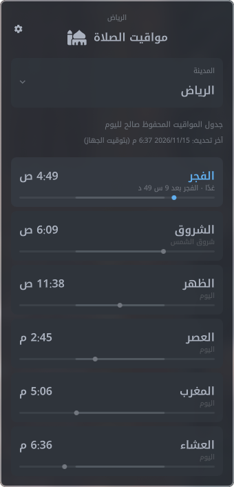
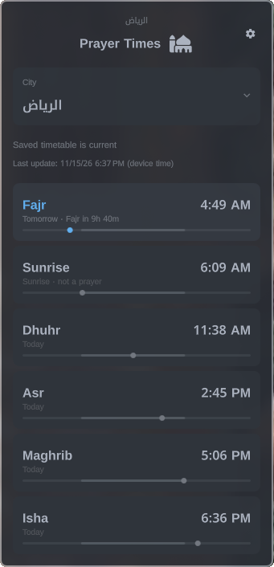
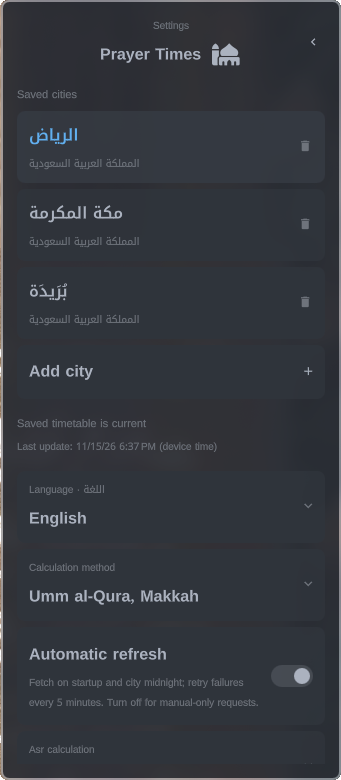

# مواقيت الصلاة · Prayer Times

[العربية](#arabic) · [English](#english)


<details>
<summary>المزيد من لقطات الشاشة · More screenshots</summary>

| جدول المواقيت بالعربية | المدن واللغة | الجمهور والحنفي |
| --- | --- | --- |
|  |  |  |

| خيارات العرض والتحديث | Timetable · English | Settings · English |
| --- | --- | --- |
|  |  |  |

</details>

<a id="arabic"></a>

## العربية

إضافة لشريط [Omarchy](https://omarchy.org/) تعرض عدّادًا للصلاة القادمة،
وجدول المواقيت اليومي، ومدنًا محفوظة، بألوان تتبع سمة النظام.
تتبع لغة النظام افتراضيًا، ويمكن اختيار لغة مستقلة للإضافة. يتبع اتجاه
الواجهة وتنسيق الأرقام اللغة المختارة، وتُستخدم الإنجليزية عند غياب الترجمة.

### الأصل والترخيص

**مبنية على [Omarchy Quattro Prayer Times](https://github.com/husamemadH/omarchy-quattro-prayer-times)
من تطوير [حسام عماد — Husam Emad](https://github.com/husamemadH).**
هذه نسخة مشتقة ومخصصة يتولى صيانتها [ThabetFY](https://github.com/ThabetFY)،
وليست المشروع الأصلي.

المشروع الأصلي مرخّص برخصة MIT. حُفظ إشعار حقوق مؤلفه ونص الرخصة كاملًا
في [LICENSE](LICENSE)، وتخضع التخصيصات أيضًا لرخصة MIT.
تشمل التعديلات إدارة المدن، وحساب العدّ التنازلي حسب المنطقة الزمنية،
وإعدادات بتصميم البطاقات، والتحقق من البيانات، وطلبات شبكة محدودة،
وترجمات عربية وإنجليزية، وخيار التحديث اليدوي، وإعادة المحاولة، واختبارات الإصدار.

### المزايا

- الصلوات الخمس مع الشروق، وإبراز الصلاة القادمة.
- عدّ تنازلي حسب توقيت المدينة، باستخدام موعد فجر الغد الفعلي بعد العشاء.
- حفظ ما يصل إلى ثماني مدن والتبديل بينها دون تغيير إعدادات الطقس.
- اختيار طريقة الحساب من Aladhan ونظام الوقت: 12 أو 24 ساعة.
- اختيار حساب العصر حسب الجمهور أو المذهب الحنفي، مع عرض حالة الجلب وآخر تحديث.
- صفحة إعدادات مستقلة، ودعم لوحة المفاتيح، وألوان تتبع سمة Omarchy.
- لغة مستقلة للإضافة؛ يمكن إضافة لغة بملف JSON وسطر في سجل اللغات.
- تنبيهات اختيارية قبل الأذان وعنده وللإقامة، بإعداد مشترك أو لكل صلاة، وصوت محلي اختياري.
- لا تحديد تلقائي للموقع، ولا خدمة خلفية، ولا قياس لاستخدام الإضافة، ولا تثبيت بصلاحيات إدارية.

قد تختلف المواقيت المحسوبة عن مواقيت مسجدك. تحقّق من طريقة الحساب والجدول
لدى جهة محلية موثوقة. لا تتضمن الإضافة ملف أذان؛ يمكنك اختيار ملف تنبيه من جهازك.

### المتطلبات

Omarchy Quattro مع واجهة الإضافات و`Commons.Translations`، وQuickshell،
وخط Nerd Font المعتاد في Omarchy. أوامر التشغيل المطلوبة: Bash وcurl وjq
وأدوات GNU coreutils، ومنها `date` و`head` و`mktemp` و`mkdir` و`mv` و`rm` و`stat` و`dirname`.
يلزم اتصال بالإنترنت للبحث عن المدن وجلب المواقيت. يُستخدم Node.js لاختبارات التطوير فقط.
الصوت الاختياري يستخدم `pw-play` من PipeWire الموجود في Omarchy.

### التثبيت

```sh
omarchy plugin add https://github.com/ThabetFY/omarchy-prayer-times.git --enable
```

معرّف الإضافة: `thabetfy.prayer-times`. افتح أيقونة المسجد، وابحث عن مدينتك،
ثم اختر النتيجة المطابقة للمنطقة والدولة. لا تُرسل طلبات قبل البحث أو اختيار
مدينة. تحقّق من طريقة الحساب في الإعدادات؛ الافتراضي هو رابطة العالم الإسلامي
(`3`)، وطريقة أم القرى تحمل الرقم `4`.

### اختيار لغة الإضافة

افتح الإضافة ← **الترس ← اللغة · Language**:

- **لغة النظام / Follow system**: الخيار الافتراضي؛ تتغير لغة الإضافة مع لغة Omarchy مباشرة.
- **العربية**: تبقى الإضافة بالعربية حتى لو كان النظام بالإنجليزية.
- **English**: تبقى الإضافة بالإنجليزية حتى لو كان النظام بالعربية.

يُحفظ الاختيار لهذه الإضافة فقط، دون تغيير لغة سطح المكتب أو إعادة تشغيل
الصدفة. تتبعه النصوص والأرقام واتجاه الواجهة وعمليات البحث الجديدة عن المدن.
تبقى أسماء المدن المحفوظة كما كانت عند اختيارها.

لإضافة لغة جديدة، راجع [دليل الترجمة](i18n/README.md).

### التحكم

مرّر للوصول إلى بقية الإعدادات. تعرض اللوحة حالة الجلب وآخر تحديث ناجح بتوقيت
الجهاز. عند فشل التحديث، يبقى الجدول السابق متاحًا حتى انتهاء صلاحيته.

من **حساب وقت العصر** اختر **الجمهور** (الشافعي والمالكي والحنبلي، وهو
الافتراضي) أو **الحنفي**. يُرسل الخيار إلى Aladhan
بقيمة `school=0` أو `school=1`. تغيير الخيار يبطل الجدول السابق؛ إذا أوقفت
التحديث التلقائي، اضغط زر التحديث لجلب المواقيت بالطريقة الجديدة.

من الإعدادات، أوقف **إظهار العدّ التنازلي في الشريط** لعرض أيقونة المسجد فقط.
تبقى معلومات الصلاة القادمة في التلميح عند تمرير المؤشر وفي الجدول.
الخيار مفعّل افتراضيًا، ويُحفظ باسم `showCountdown`.

**الترس ← تنبيهات الصلاة**: التنبيهات والصوت معطّلان افتراضيًا. عند تفعيل
التنبيهات في إعداد جديد، يعمل **لكل صلاة** و**عند الأذان**؛ ويبقى **قبل الأذان**
و**الإقامة** معطّلين. الإعدادات المحفوظة لها الأولوية.
راجع [الدقائق الافتراضية والإعدادات](docs/notifications.md).

| الإجراء | النتيجة |
| --- | --- |
| النقر الأيسر | فتح جدول المواقيت أو إغلاقه |
| النقر الأيمن أو الأوسط | جلب المواقيت مجددًا |
| الترس / سهم الرجوع | فتح الإعدادات / العودة إلى الجدول |
| قائمة المدن | التبديل بين المدن المحفوظة |
| Tab وEnter وSpace | التنقل بين عناصر التحكم وتفعيلها |
| سهم أعلى/أسفل أو j/k | التنقل في قائمة مفتوحة |
| Escape | إغلاق القائمة، ثم اللوحة |

تحتوي الإعدادات على إدارة المدن والبحث وطريقة الحساب واللغة والتحديث التلقائي
ونظام الوقت وزر التحديث اليدوي. أوقف **التحديث التلقائي** لمنع طلبات المواقيت
التلقائية؛ قد يكتمل أي طلب بدأ بالفعل قبل إيقافه.

### الخصوصية والتخزين

- يُرسل نص البحث ورمز اللغة الفعالة الأساسي إلى
  `https://geocoding-api.open-meteo.com/v1/search` عند الضغط على البحث أو Enter فقط.
  تستخدم خدمة [Open-Meteo](https://open-meteo.com/) بيانات GeoNames.
- عند اختيار مدينة، يكون التحديث التلقائي مفعّلًا افتراضيًا. تُرسل الإحداثيات
  والمنطقة الزمنية وطريقة الحساب وخيار حساب العصر والتاريخ إلى
  `https://api.aladhan.com/v1/timings/<date>` لجلب مواقيت اليوم وفجر الغد.
  يتم الجلب عند التحميل، وتغيير المدينة أو الطريقة، ومنتصف الليل في المدينة
  إذا لم يتوفر جدول حديث مطابق، وكذلك عند التحديث اليدوي. عند الفشل، لا تتكرر
  المحاولة التلقائية أكثر من مرة كل خمس دقائق لكل نسخة من الودجت.
  تُعاد الاستفادة من الجداول الحديثة في الذاكرة أو آخر جدول محفوظ؛
  قد تجلب كل شاشة المواقيت بشكل مستقل.
- تتلقى الخدمتان عنوان IP عبر طلبات HTTPS العادية. لا تُقرأ بيانات موقع الطقس
  أو GPS، ولا تُستخدم خدمة لتحديد الموقع عبر IP، ولا يلزم حساب أو مفتاح API.
- مهلة الاتصال ثلاث ثوانٍ، ومهلة الاستجابة الكاملة ثماني ثوانٍ لكل طلب،
  والحد الأقصى للاستجابة 64 KiB. تُستخدم HTTPS فقط دون اتباع إعادة التوجيه.
- تُحفظ الإعدادات في مدخل الإضافة داخل `~/.config/omarchy/shell.json`:
  `cities` و`city` و`calculationMethod` و`asrSchool` و`clock12` و`autoRefresh` و`showCountdown` و`language`، و[إعدادات التنبيهات](docs/notifications.md).
  قيمة اللغة الافتراضية `system`، ويمكن استخدام رمز مسجل في `i18n/languages.json`.
- يُحفظ آخر جدول جُلب، بما فيه المدينة المختارة، بشكل ذري وبصلاحيات خاصة في
  `${XDG_STATE_HOME:-~/.local/state}/omarchy/plugins/thabetfy.prayer-times/timetable.json`.
  لا يُعرض إلا جدول مطابق وغير منتهي الصلاحية؛ تُزال المواقيت القديمة بدل
  تقديمها على أنها مواقيت اليوم.

مثل جميع إضافات الصدفة، تعمل هذه الإضافة **دون عزل أمني** وبصلاحيات مستخدمك.
راجع الشيفرة قبل التثبيت. لا يُنفَّذ أي محتوى محمّل من الإنترنت.

### الانتقال من `local.prayer-times`

لهذه النسخة معرّف ومسار تخزين مستقلان؛ لا تستبدل الإضافة الأصلية أو ملفاتك
الشخصية. اختر مدنك مجددًا في النسخة الجديدة، ثم عطّل القديمة بعد التأكد من
عملها. تشغيل النسختين معًا قد يكرر طلبات الشبكة. يجب أن تكون ملفات الإصدار
ملفات عادية، وليست روابط رمزية إلى ملفاتك الشخصية.

### التحديث والإزالة

```sh
omarchy plugin update thabetfy.prayer-times
omarchy plugin remove thabetfy.prayer-times
```

إذا بقيت قيم قديمة في الواجهة بعد التحديث، شغّل `omarchy restart shell`.

لا تترك الإزالة خدمة أو مهمة مجدولة. قد يبقى ملف التخزين
المؤقت؛ يمكنك حذفه اختياريًا بالأمر التالي:

```sh
rm -- "${XDG_STATE_HOME:-$HOME/.local/state}/omarchy/plugins/thabetfy.prayer-times/timetable.json"
```

### التطوير والتحقق

```sh
bash tools/check.sh
```

تستخدم الاختبارات استجابات شبكة وهمية ومجلدات مستخدم مؤقتة. راجع
[دليل المساهمة](CONTRIBUTING.md).

---

<a id="english"></a>

## English

[↑ العربية](#arabic)

A theme-aware [Omarchy](https://omarchy.org/) bar widget with a next-prayer
countdown, daily timetable, and saved cities. Arabic and English follow the
shell language by default, or choose a language just for this widget. Layout
direction and number formatting follow that choice. Missing translations fall back to English.

## Credits and license

**Based on [Omarchy Quattro Prayer Times](https://github.com/husamemadH/omarchy-quattro-prayer-times)
by [Husam Emad](https://github.com/husamemadH).** This is a customized derivative
maintained by [ThabetFY](https://github.com/ThabetFY), not the upstream project.

The original code is licensed under MIT. Its copyright notice and full license
are preserved in [LICENSE](LICENSE); the customizations are also MIT-licensed.
Changes include saved-city management, timezone-aware scheduling, card-based
settings, bounded network requests, validation, Arabic/English catalogs,
manual-only refresh, offline retries, and release tests.

## Features

- Five daily prayers plus sunrise, with the next prayer highlighted.
- Countdowns use the selected city's timezone, including tomorrow's actual Fajr.
- Save up to eight cities; switch cities without changing your weather settings.
- Choose an Aladhan calculation method and a 12- or 24-hour clock.
- Standard/Hanafi Asr calculation, fetch status, and last-successful-update time.
- Separate settings page with keyboard-accessible cards and native shell colors.
- Independent language selector; adding languages needs only JSON files and a registry entry.
- Optional before-adhan, at-time and Iqama alerts, shared or per prayer, with an optional local sound.
- No IP geolocation, privileged installer, background service, or telemetry.

Calculated times may differ from your local mosque. Verify the method and
timetable with a trusted local authority. No adhan file is bundled; you may choose a local alert sound.

## Requirements

Omarchy Quattro with the plugin API and `Commons.Translations`, Quickshell, and
the standard Omarchy Nerd Font. Runtime commands: Bash, curl, jq, and GNU coreutils
(`date`, `head`, `mktemp`, `mkdir`, `mv`, `rm`, `stat`, `dirname`). Internet access is needed
for city search and timetable fetching. Node.js is only needed for development tests.
Optional audio uses PipeWire's `pw-play`, supplied with Omarchy.

## Install

```sh
omarchy plugin add https://github.com/ThabetFY/omarchy-prayer-times.git --enable
```

Plugin ID: `thabetfy.prayer-times`. Open the mosque icon, search for a city, and
select the matching region/country. Nothing is fetched until you search or select
a city. In Settings, verify the calculation method (default: Muslim World League,
`3`; Umm al-Qura is `4`).

### Widget language

Open the widget → **gear → Language · اللغة**:

- **Follow system** (default): follows Omarchy's language live.
- **English**: keeps the widget in English even on an Arabic desktop.
- **العربية**: keeps the widget in Arabic even on an English desktop.

The choice is saved immediately for this widget only; no desktop-language change
or shell restart is needed. UI text, digits, layout direction, and new city searches
follow it. Existing saved city names are kept as originally selected.

To contribute another language, see [i18n/README.md](i18n/README.md).

## Controls

Scroll to reach additional settings. The panel shows fetch status and the last
successful update in device time. A failed refresh keeps the previous timetable
until it expires.

Under **Asr calculation**, choose **Standard** (Shafi‘i, Maliki, Hanbali; the
default) or **Hanafi**. This sends `school=0` or
`school=1` to Aladhan. Changing it invalidates the old timetable; press Refresh
to fetch the new calculation if automatic updates are off.

In Settings, turn off **Show countdown in bar** for an icon-only widget.
The hover tooltip and timetable still show the next prayer. This option defaults
to on and is saved as `showCountdown`.

**Gear → Prayer notifications**: alerts and sound are off by default. Enabling
alerts in a new setup selects **Per prayer** and **At time**; **Before** and
**Iqama** remain off. Saved settings take priority.
See [minute presets and settings](docs/notifications.md).

| Action | Result |
| --- | --- |
| Left-click | Open or close the timetable |
| Right- or middle-click | Force a timetable refresh |
| Gear / back arrow | Open settings / return to timetable |
| City selector | Switch between saved cities |
| Tab, Enter, Space | Navigate and activate controls |
| Up/Down or j/k | Navigate an open dropdown |
| Escape | Close a dropdown, then the panel |

Settings contains saved-city removal, city search, calculation method, automatic
refresh, clock format, and a manual Refresh button. Disable **Automatic refresh**
for manual-only timetable requests; an already-running request may finish.

## Privacy and storage

- Search sends the query and the effective UI language's base code to
  `https://geocoding-api.open-meteo.com/v1/search` only on Search or Enter.
  [Open-Meteo](https://open-meteo.com/) geocoding uses GeoNames data.
- When a city is selected, automatic refresh defaults to on. Coordinates,
  timezone, calculation method, Asr school and date are sent to
  `https://api.aladhan.com/v1/timings/<date>` for today and tomorrow's Fajr.
  Fetching occurs on load, city/method changes, and city midnight if no fresh
  matching timetable is cached, as well as on manual refresh.
  Failed automatic fetches retry no more than once every five minutes per widget
  instance. Fresh city schedules are reused from memory or the last saved timetable.
  Multiple monitors may each fetch.
- Both services receive your IP address through ordinary HTTPS requests. No weather
  location, GPS, IP-location API, account, or API key is used.
- Requests have a 3-second connection timeout, an 8-second total timeout per
  response, a 64 KiB response limit, HTTPS-only transport, and no redirect following.
- Settings live on this widget's entry in `~/.config/omarchy/shell.json`:
  `cities`, `city`, `calculationMethod`, `asrSchool`, `clock12`, `autoRefresh`, `showCountdown`, and `language`
  (`system` by default, or a code registered in `i18n/languages.json`), plus [notification settings](docs/notifications.md).
- The last fetched timetable is written atomically with private permissions to
  `${XDG_STATE_HOME:-~/.local/state}/omarchy/plugins/thabetfy.prayer-times/timetable.json`.
  It includes the selected city. Only a matching, unexpired cache is displayed.
  Expired timetables are cleared rather than presented as today's times.

Like all shell plugins, this runs **unsandboxed** with your user permissions.
Review the source before installing. No downloaded content is executed.

## Migrating from `local.prayer-times`

This uses a new plugin ID and private cache path, so it does not overwrite the
original plugin or dotfiles. Select your cities again in the new widget. Disable
the old widget once you are satisfied; leaving both enabled can duplicate requests.
Do not publish symlinked dotfiles as a plugin: release files must be regular files.

## Update and remove

```sh
omarchy plugin update thabetfy.prayer-times
omarchy plugin remove thabetfy.prayer-times
```

If old values remain visible after updating, run `omarchy restart shell`.

Removal leaves no service or scheduled job. The cache may remain;
optionally remove its file with:

```sh
rm -- "${XDG_STATE_HOME:-$HOME/.local/state}/omarchy/plugins/thabetfy.prayer-times/timetable.json"
```

## Development

```sh
bash tools/check.sh
```

Tests stub network access and use temporary homes. See [CONTRIBUTING.md](CONTRIBUTING.md).
